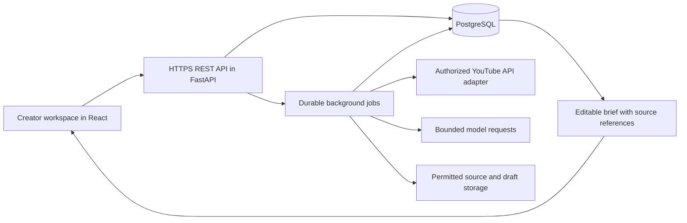

# YT-Agent: repository review and product plan

Reviewed 20 November 2026. Repository: `https://github.com/naveenthammu/YT-Agent`. Commit: `bf63e5152933414ebfebd9a6288439db0d1f1572`.

**Finding: this repository is a project placeholder. It contains no implemented agent or application.** All product suggestions below are proposals, not descriptions of existing features.

## 1. Files reviewed and remote verification

The complete project-file inventory at the start of this review was:

| File | Size | Complete content |
|---|---:|---|
| `README.md` | 10 bytes | `# YT-Agent` |

The README was read in full. Its SHA-256 is `2870f4c3a5fe51d9c59b63449bf5ea1cb503656981241b36a5135dfe01aef994`.

`git ls-files`, a filesystem listing excluding Git's internal metadata, and the history all agree: there was one project file and one initial commit. `git ls-remote --heads --tags origin` returned only `refs/heads/main` at the same commit, with no advertised tags or additional branches. The working tree was clean before this report was added. This proves the state of this repository at inspection time, not the absence of code on somebody else's computer or in another repository.

No application was run because there is no entry point, source code or dependency manifest. There are no tests to execute. This report is the only project content added during the review.

## 2. How it works today

Today it stores a project name in a README. It does not implement video research, AI generation, analytics, uploading, scheduling or any other workflow. There is no evidence identifying what “YT” stands for, although YouTube is a reasonable interpretation of the name.

The owner has been asked whether the intended product is research/planning, video creation/publishing, analytics, or code located elsewhere. Until that is confirmed, the YouTube-specific proposal below is conditional. This project is independent of EDITH; the voice-assistant architecture and pricing from that project do not establish requirements here.

## 3. What is missing

| Area | Current evidence | Required before a paid release |
|---|---|---|
| Product definition | Name only | Target customer, expensive/repetitive task, supported inputs, useful output and explicit limits |
| Application | No source or entry point | A working end-to-end workflow, frontend, backend and error handling |
| Data and integrations | None | Authorized data sources, API access, data provenance, quota budgets and disconnect/deletion behavior |
| AI behavior | None | Prompt/model configuration, structured outputs, grounding, quality evaluation and cost limits |
| Accounts and storage | None | Authentication, workspaces, server-side authorization and database migrations/backups |
| Commercial operation | None | Pricing, billing, entitlements, cancellation, refunds and customer support |
| Deployment | None | Reproducible dependencies, environment instructions, CI, deployment, monitoring and rollback |
| Verification | None | Unit/integration tests plus real user acceptance tests covering the delivered workflow |
| Documentation and rights | Heading only; no licence file | Setup/demo documentation, intended proprietary/open-source model, dependency notices and appropriate terms/privacy disclosures |

These are absent capabilities, not discovered exploitable security bugs. There is no codebase from which to calculate a meaningful “percentage complete.”

## 4. Recommended first product, if this means YouTube

**Provisional recommendation: a research-to-content-brief assistant for one type of creator.** This is easier to validate and operate than a complete video-generation/publishing platform, while leaving those capabilities as explicit later options.

The initial promise could be: “Turn your channel goals and approved research into an editable plan for your next video.” Choose one creator segment and one language after interviews; do not claim demand merely because YouTube is a large platform.

Proposed workflow:

1. A creator supplies their channel, audience, topic and approved reference material.
2. The application retrieves only permitted data, labeling sources and retrieval time. Private channel analytics requires the owner's authorization.
3. It proposes a small set of topic angles, clearly separating observed facts from editorial suggestions.
4. The creator chooses an angle; the application creates an outline, title alternatives, description draft and thumbnail brief.
5. The creator edits and exports the result. Publishing remains an explicit later feature.
6. With authorization, a later feedback loop compares the creator's published results with their own baseline. It does not promise a causal explanation or guaranteed views.

Potential differentiators to test include a specific regional-language workflow, a particular educational niche, or an agency approval process. “AI title generator” alone is weak positioning: vidIQ already offers ideas, scripts, thumbnails, coaching and channel research. Its current one-channel US list price is **US$19/month for Boost**, or **US$199 paid yearly**; local checkout prices may differ. [vidIQ plans](https://vidiq.com/plans/)

Other viable directions need different designs:

| Direction | Additional work and commercial tradeoff |
|---|---|
| Channel analytics | OAuth, reliable data sync, metric definitions and permissions; insight quality matters more than producing another dashboard |
| Video creation and publishing | Media rights, rendering, storage/egress, previews, upload recovery, scheduling and explicit publish approval; much higher variable cost and operational complexity |
| Research/content planning | Data provenance, grounded drafts, useful editing/export and quotas; lower media-processing cost but established competition |

## 5. Practical architecture for the proposed planning MVP

This is a suggested baseline, not an existing stack:

- **React/TypeScript frontend:** onboarding, brief editor, job status, source view, export and plan usage.
- **FastAPI with REST:** validate requests, enforce workspace membership and usage limits, keep provider credentials off the browser. REST is the interface style; FastAPI is a framework implementing it.
- **PostgreSQL:** users, workspaces, channel connections, source metadata, briefs, job state, subscription events and usage. Object storage is optional until files/media justify it.
- **Background processing:** durable job IDs, bounded retries/timeouts, cancellation and recorded provider cost. Retrying a job must not create duplicate charges or duplicate uploads.
- **AI integration:** start with one measured provider/model path, structured output and a fixed task budget. Add retrieval over creator-provided brand material only if it improves evaluations. A vector database and multi-agent framework are not prerequisites for the first brief.
- **Security:** server-side tenant checks, encrypted OAuth tokens, minimum scopes, secret management, input/URL validation, and treating retrieved text as data rather than instructions. Resolve supported YouTube IDs through official APIs rather than fetching arbitrary user-supplied server URLs.
- **Publishing, if added:** show the exact channel, video, metadata, visibility and schedule for approval; set visibility explicitly and reconcile upload results before retrying. Do not publish merely because text in a retrieved source says to do so.

Technology should follow the chosen workflow. There is no repository evidence requiring Rust, Kubernetes, a GPU server or a complex agent orchestration layer at this stage.

## 6. Platform constraints that affect the product

The following are current official documentation findings, checked on 20 November 2026; verify them again against the actual API project before launch.

1. **Shared quota constrains customer promises.** Current default allocations are separate buckets of 100 `search.list` calls/day and 100 `videos.insert` calls/day, each costing one unit per call in its bucket, plus 10,000 daily units for other endpoints. Pagination adds calls. These are project allowances, not 100 calls for each paying customer. Confirm actual Cloud Console allocations and meter usage. [Quota calculator](https://developers.google.com/youtube/data/determine_quota_cost)
2. **Private analytics is permissioned.** Ordinary channel analytics requires an owning user's OAuth authorization. An API key cannot reveal competitors' private retention or revenue. Service-account support is limited to eligible Content Manager content-owner requests, not ordinary channel impersonation. [Authorization guide](https://developers.google.com/youtube/reporting/guides/authorization)
3. **Do not assume arbitrary public transcripts are available.** Official caption downloads require permission to edit the video and OAuth, and cost 200 quota units. Creator-provided transcripts or authorized channel media are more defensible inputs than a promise to transcribe every public URL through the official API. [Caption downloads](https://developers.google.com/youtube/data/reference/rest/v3/captions/download)
4. **Retention and provenance need implementation.** The developer policies restrict scraping and impose refresh/deletion rules on stored API data. Most data needs refresh or deletion within 30 days; particular authorized statistics have exceptions. User deletion and in-app revocation require deletion within seven days. Implement a data-class-specific retention matrix, disconnect controls and deletion jobs rather than retaining everything forever. [Developer policies](https://developers.google.com/youtube/terms/developer-policies)
5. **Derived analytics needs eligibility review.** The general restrictions and available amendment matter before offering a proprietary “viral score,” sentiment analysis or long-term derived history. Do not assume permission from technical API access alone. [Additional metrics and storage policy](https://developers.google.com/youtube/terms/derived-metrics-policy)
6. **Upload guidance recently changed.** The official revision history records removal of the private-only restriction for unverified API-project uploads on 2 November 2026. The current upload reference says omitted visibility defaults to public, subject to some creator-account settings. Set it explicitly; do not rely on the old private-upload assumption as a safeguard. OAuth verification, quota/compliance review and other applicable obligations still need separate assessment. [Revision history](https://developers.google.com/youtube/data/revision_history), [Upload reference](https://developers.google.com/youtube/data/reference/rest/v3/videos/insert)
7. **AI output does not assure monetization.** Mass-produced/repetitive inauthentic content and insufficiently transformed reused content can be ineligible. AI assistance is not categorically banned. The product should help creators produce original value and make editorial decisions, without revenue guarantees. [YouTube monetization policies](https://support.google.com/youtube/answer/1311392?hl=en)

## 7. What to build first

| Stage | Deliverable | Exit condition |
|---|---|---|
| Define | One-page customer/problem/workflow spec, five creator interviews, sample input/output | At least three prospects want to test the same defined workflow |
| Prototype | One complete brief-generation and edit/export flow using permitted sources | Representative users finish the task; facts have traceable references; failures show useful errors |
| Private pilot | Accounts, isolation, source retention/deletion, measured usage, billing terms, support | Three paid pilots using a working product, after scope and terms are agreed |
| Launch | Reproducible deploy, backup/restore, monitoring, quotas, cancellation/export, support docs | At least two pilots renew, and measured cost/support fits the price |
| Expand | Analytics feedback or media/publishing features selected by demand | Separate data-access, cost, quality and approval tests for the new workflow |

Before public sale, verify unauthorized users cannot read another workspace's connections/drafts; disconnecting stops sync; deletion removes the relevant stored data; quota exhaustion fails safely; duplicate billing events do not duplicate entitlements; and model responses do not invent quoted channel statistics. Test backup recovery and payment failure/cancellation. Publishing tests apply only if publishing is actually implemented.

Measure creator editing time and acceptance rate against their current process. Proposed pilot goals are a 25% median reduction in brief preparation time and renewal by two of three pilot customers; these are decision thresholds, not promised outcomes or market statistics.

## 8. Pricing and running costs

It is too early to quote an evidence-based monthly infrastructure total: the repository does not define a workload, model, storage volume or rendering requirement.

For the proposed text-planning product only, **₹999/month for one channel and up to 20 briefs** could be a price experiment, with applicable taxes stated separately. A brief must be defined—for example, one outline, title alternatives and a thumbnail brief, with a bounded number of revisions. This is not a market-validated price, and it is not suitable as an unlimited video-generation promise.

Measure before finalizing:

`monthly contribution = subscription revenue − model/embedding usage − payment/refund costs − customer support − allocated hosting/storage/backup costs`

Track typical and heavy usage, retries and support time. Keep YouTube quota capacity as a separate constraint: a positive cash margin does not mean API capacity is available. Start with bounded plans; introduce costly image/video processing as separately metered functionality if customers want it.

A basic web service needs hosting, database backups, domain/email, monitoring and a payment processor. Media creation adds rendering, licensed assets, large-file storage and egress. Obtain provider quotes after choosing the workflow and measuring a prototype; avoid treating an introductory VPS advertisement as the complete operating cost.

## 9. Immediate next action

Confirm what YT-Agent is supposed to do and whether implementation exists elsewhere. If this is the correct starting repository, create the product specification and one end-to-end prototype before investing in a broad feature list. The current repository cannot be sold as working software; the plan above provides a path to testing whether a product built from it would deserve a subscription.
